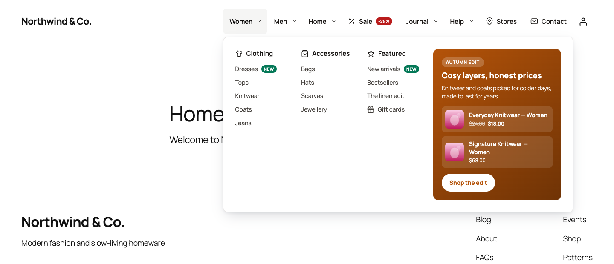

# DEV3 AI Mega Menu for WordPress

Accessible mega menus with columns, tabs, flyouts, products, posts and promos. DEV3 AI builds, labels and audits your menu.



## Features

DEV3 AI Mega Menu turns any WordPress menu into a fast, accessible mega menu, in classic and block themes.

**Menus and panels**

* Mega panels with automatic columns, or custom rows and columns on a 12-column grid
* Tabbed mega panels, flyout dropdowns at any depth, image and icon items
* Panel widgets: menu columns, recent posts, WooCommerce products, search box, image, promo block, HTML, shortcode and synced patterns (reusable blocks)
* Badges ("New", "Sale", "Hot" or a custom colour), 60 built-in line icons, item images and descriptions
* Hover or click triggers, sticky bar, accordion or off-canvas mobile menu, configurable breakpoint
* Style presets plus a visual style editor with a live preview
* Keyboard and screen-reader accessible (WAI disclosure pattern, ARIA tabs, focus trap, Escape, arrow keys; WCAG 2.2 AA)
* Classic themes (theme locations), block themes (block, or automatic replacement of the Navigation block), shortcode, Elementor widget and WPBakery element
* Front-end: about 3 KB of JavaScript and 8 KB of CSS (gzipped), no dependencies, no AI calls on page load

**DEV3 AI features (your own Google AI API key)**

* Build my menu: reads your pages, categories and products and proposes a complete mega menu
* Labels and short descriptions for every item, in your site's language
* Menu UX audit: too deep, crowded, unclear labels, broken and dead-end links, missing pages, with one-click fixes
* AI promo panel: a seasonal promo block with featured products
* Icon and image suggestions for each item

Every AI result is a draft. Nothing changes on your site until you accept it. Everything except the AI tools works without an API key, and an automatic builder, a quick audit, keyword icon matching and promo templates work without AI.

## Requirements

- WordPress 6.0 or newer (tested up to 6.8)
- PHP 7.4 or newer
- Optional: your own Google AI API key (from Google AI Studio) to switch on the DEV3 AI features. The rest of the plugin works without one.

## Installation

### From the release zip

1. Download `dev3-ai-mega-menu.zip` from the [latest release](https://github.com/dev3tech/dev3-ai-mega-menu/releases/latest).
2. In WordPress, go to **Plugins → Add New → Upload Plugin**, choose the zip and click **Install Now**.
3. Click **Activate**.

### Build from source

```bash
git clone https://github.com/dev3tech/dev3-ai-mega-menu.git
cd dev3-ai-mega-menu
composer install --no-dev
npm ci
npm run build
```

Then copy the `dev3-ai-mega-menu` folder into `wp-content/plugins/` and activate it.

### Getting started

1. Upload the plugin zip under Plugins > Add New > Upload Plugin and activate it.
2. Open DEV3 AI Mega Menu in the admin menu.
3. Build a menu (Menu Builder or AI Studio > Build my menu).
4. Classic themes: Locations > turn on "Use the DEV3 AI Mega Menu here". Block themes: add the "DEV3 AI Mega Menu" block to your header, or set "Replace the Navigation block".
5. Optional: add your Google AI API key under API Config.

## FAQ

### Does it work without an API key?
Yes. Menus, panels, widgets, styles, locations, the automatic builder and the quick audit all work without AI.

### Does AI run when visitors load a page?
No. AI only runs when an administrator clicks a DEV3 AI button. The front end makes no AI calls.

### Which page builders are supported?
Gutenberg (block), Elementor (widget), WPBakery (element), and any builder that runs shortcodes: [dev3mm_menu menu="main-menu"].

## Privacy

The AI tools send menu labels, page/category/product titles and IDs to Google AI. No visitor data is sent. See the HTML documentation for details.

## Documentation

The full HTML guide (installation, settings, hooks and FAQ) is in [`docs/index.html`](docs/index.html). Open it in a browser after cloning or downloading the repository.

## Changelog

### 1.0.0
* Initial release.

## Licence

Released under the GNU General Public License v2.0 or later (GPL-2.0-or-later). See [LICENSE](LICENSE).

## More from DEV3

- [DEV3 AI Mega Menu for WordPress on the DEV3 Marketplace](https://www.dev3.tech/item/dev3-ai-mega-menu)
- [More WordPress plugins, themes and templates from DEV3](https://www.dev3.tech/marketplace)
